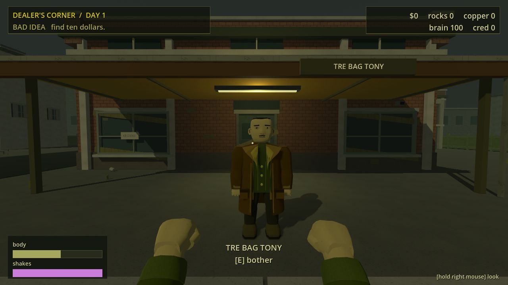

# 3D character and street refinement — 2026-11-18

Branch: `codex/3d-character-street-polish`, based on menu-fix commit
`63eb32ff4758cd6463ab95c6ef08354f9c9cd8a8`. The final delivery response records this report's
commit hash and confirmed origin push. Decision register: **IMPL-3D-ART-02** in
[`REFACTOR-FINDINGS.md`](../REFACTOR-FINDINGS.md). Contract captured before implementation:
[`SPEC-3D-CHARACTER-STREET.md`](../SPEC-3D-CHARACTER-STREET.md).

## Result

The six existing residents, first-person fists and Block received an original low-poly art
refinement. Schedule I's readable caricatures, matte materials and layered low-rise streets
were visual direction; no reference meshes/textures or stock assets were imported.

- Connected facial/body forms, selective smooth shading, fitted eyes/hair/beard, distinct
  silhouettes, Tony's three coat layers, revised fists, Brutus and the helmeted possum.
- Deep storefront bays/transoms, layered awnings, smaller mounted signs, side walls, varied
  roofs and distant buildings. Grouped curb/yard props have collision where needed.
- Coherent zebra crossing, gutters/inlets/manholes, flush repairs and loading/parking marks.
  Removed the scattered raised-looking rectangular ground stamps.
- Cached original mipmapped tiles with smaller masonry courses, smooth periodic wear and
  restrained skin/cloth grain. Balanced cream/slate lighting and 4x MSAA improve separation.

The active 2D release and frozen v19 are untouched. Existing actor identities, pivots, gameplay,
loop, save namespace and browser menu/capture correction are preserved. This is a visual
increment to the slice, not full neighborhood/AI parity; operator eye review remains open.

## Visual evidence

All comparison images use native 1280x720 captures from the production scene. The before camera
set was captured from the baseline before edits. Portraits use a separate 48-degree QA camera;
the production gameplay camera and performance cameras are restored afterward.

| View | Before | After |
| --- | --- | --- |
| Block | [before](../artifacts/3d-character-street/before_block.png) | [after](../artifacts/3d-character-street/block.png) |
| Tony and fists | [before](../artifacts/3d-character-street/before_tony.png) | [after](../artifacts/3d-character-street/tony.png) |
| Pete/shop | [before](../artifacts/3d-character-street/before_pete.png) | [after](../artifacts/3d-character-street/pete.png) |
| Street | [before](../artifacts/3d-character-street/before_street.png) | [after](../artifacts/3d-character-street/street.png) |

Final portraits: [Tony](../artifacts/3d-character-street/portrait_tony.png),
[Pete](../artifacts/3d-character-street/portrait_pete.png),
[Yuri](../artifacts/3d-character-street/portrait_yuri.png),
[Lurch](../artifacts/3d-character-street/portrait_lurch.png),
[possum](../artifacts/3d-character-street/portrait_possum.png),
[Brutus](../artifacts/3d-character-street/portrait_brutus.png).
Night views: [Block](../artifacts/3d-character-street/block_night.png),
[Tony](../artifacts/3d-character-street/tony_night.png),
[Pete](../artifacts/3d-character-street/pete_night.png).



## Gates and exported behavior

Commands: `node tools/run-gates.mjs`, `pwsh -File game3d/tests/run-gates.ps1`,
`pwsh -File game3d/tools/render-probe.ps1 -Output .build/character-street/after -Stress`,
`pwsh -File game3d/tools/build.ps1`, native `--qa-tour`, and packaged Windows headless boot.

```text
GATE RUNNER: 19/19 PASS
corpus-gate: PASS — corpus intact.
3D SIMULATION GATE: PASS (106 checks; transactions, exact 18/8 boundary, daily governors, death and save normalization)
3D SCENE GATE: PASS (92 checks; scene boot, physical rays, collision, menus, real loop, persistence, recovery and browser capture/fallback controls)
3D ART GATE: PASS (196 checks; deterministic periodic tiles, transformed geometry, bounded character meshes, selective normals, render state and untouched pivots/collision)
3D GATE RUNNER: 3/3 PASS (import clean; simulation, scene and art)
3D TOUR: purchase and real smoke true
3D TOUR: timers 0.0 / 0.0
3D TOUR: observed crash at 18.004s; cycle complete at 26.009s
3D TOUR: save schema 1.0
3D TOUR: PASS
3D CAPTURE: PASS
3D BUILD: PASS (All; Godot 4.5.1.stable.official.f62fdbde1; outputs: C:\Users\zenit\projects\Rock Bottom\.build\3d)
```

Packaged Windows boot exited0 without engine errors. Full logs:
[legacy gates](2026-11-18-3d-character-street-legacy-gates.txt),
[3D gates](2026-11-18-3d-character-street-gates.txt),
[render](2026-11-18-3d-character-street-render.txt),
[tour](2026-11-18-3d-character-street-tour.txt),
[export](2026-11-18-3d-character-street-build.txt),
[package boot](2026-11-18-3d-character-street-boot.txt).

Live browser check at `http://127.0.0.1:8073/`: the final hashed pack loaded, wake up entered play,
W/D movement reached Tony, E opened his dialogue, leave returned to play, Escape paused, and
Continue resumed with movement. The embedded browser logged pointer-lock `WrongDocumentError`;
the existing fallback kept entry/movement/menu exits usable. Actual right-drag/captured-pointer
feel and full browser save/economy/encounter acceptance are not claimed. The production scene
gate covers fallback control logic. Browser QA made no purchase or save; the native tour uses
an isolated test save.

## Rendering cost

Same native cameras; Godot4.5.1 Compatibility/OpenGL3.3, RTX3080, 1280x720, focused window,
VSync disabled, 2s warmup then5s rendered samples. Before uses2x MSAA; after uses4x. Final JSON
records Godot viewport `msaa_3d=2` (the enum for4x). The prior setting is pinned in the baseline.

| Scene | Draws before/after | p95 rendered interval ms before/after | Median CPU process monitor ms before/after |
| --- | ---: | ---: | ---: |
| Block day, six actors | 701 / 838 | 2.596 / 3.108 | 3.360 / 3.342 |
| Block night, six actors | 749 / 886 | 2.845 / 3.530 | 3.236 / 3.956 |
| 60-character art/idle stress | 4775 / 4914 | 8.638 / 9.052 | 9.495 / 9.713 |

The stress scene is six production actors plus54 art-only animated duplicates, not60 complete
AI agents. CPU process-monitor values are separate engine samples, not GPU timings. The added
geometry and higher antialiasing increase measured cost; no speedup is claimed. Final p95 render
interval remains below16ms under these measured native conditions. No browser/hardware-wide
FPS claim follows. Raw [before](2026-11-18-3d-character-street-before.json) and
[after](2026-11-18-3d-character-street-after.json) are retained.

Static batching still combines2428 source meshes into244 surfaces; the baseline was1266/142.
The expanded world adds102 material/spatial batches while the stress draw increase is139.
This cost is visible and bounded in the measurement; reducing prop detail may be appropriate
for a later lower-spec quality preset, but no unmeasured quality-setting system is added here.

## Counterexamples, drift and property review

- First renders exposed detached moustache pieces, Pete's collar/jaw intersection, an awning
  pitched across the pawn sign and raised puddle slabs. Fixed, then captured again.
- Static review caught a shelf exactly at the ground-clearance cutoff; raised shelf/contents5cm
  so rounding cannot invent an invisible ground exclusion zone. Traversal/ray gates remain green.
- Retained larger four-to-five-head caricature proportions for recognition and recorded this
  visual refinement in the contract. No claim of uniform realistic anatomy.
- Added40 meaningful art assertions for periodic continuous bounded wear fields (including
  negative/fractional coordinates), finite bounded/grounded geometry, front-facing unit normals
  and selectively softened human heads. Existing pivot/collision/cache checks remain intact.
- No runtime mesh regeneration, external art/runtime dependencies, new NPC identities or save
  schema changes. The exact18s/8s loop, pause behavior, transactions and separate storage remain
  verified by the production gates/tour.

## Files touched

Implementation and validation:

- `game3d/project.godot`
- `game3d/scripts/character_art.gd`
- `game3d/scripts/neighborhood.gd`
- `game3d/scripts/surface_kit.gd`
- `game3d/tests/render_probe.gd`
- `game3d/tests/test_art.gd`

Contracts/continuity:

- `SPEC-3D-CHARACTER-STREET.md` (new)
- `SPEC-3D-ART-PASS.md`
- `SPEC.md`
- `DELEGATION.md`
- `REFACTOR-FINDINGS.md` (append)
- `BRAIN.md` (append)
- `game3d/README.md`

Evidence (all new):

- This report: `reports/2026-11-18-3d-character-street.md`
- Reports with the same stem: `-before.json`, `-after.json`, `-legacy-gates.txt`, `-gates.txt`,
  `-render.txt`, `-tour.txt`, `-build.txt`, `-boot.txt`.
- `artifacts/3d-character-street/`: `before_block.png`, `before_tony.png`, `before_pete.png`,
  `before_street.png`, `block.png`, `tony.png`, `pete.png`, `yuri.png`, `lurch.png`, `street.png`,
  `yard.png`, `block_night.png`, `tony_night.png`, `pete_night.png`, `portrait_tony.png`,
  `portrait_pete.png`, `portrait_yuri.png`, `portrait_lurch.png`, `portrait_possum.png`,
  `portrait_brutus.png`, `browser.jpg`.

Ignored generated outputs were rebuilt at `.build/3d/windows/RockBottom.exe` and `.build/3d/web/`.
Full probe working outputs remain under `.build/character-street/`.

## Play and remaining review

Refresh [the local browser build](http://127.0.0.1:8073/) or launch
`C:\Users\zenit\projects\Rock Bottom\.build\3d\windows\RockBottom.exe`.
If the helper needs restarting: `pwsh -File game3d/tools/serve.ps1` from the repository root.
The public GitHub Pages entry remains the original2D release; this pass does not deploy3D there.
Operator review should focus on character readability, hands, storefront scale, road surfaces,
night visibility and movement. Larger world/AI parity remains on the separate slice backlog.
