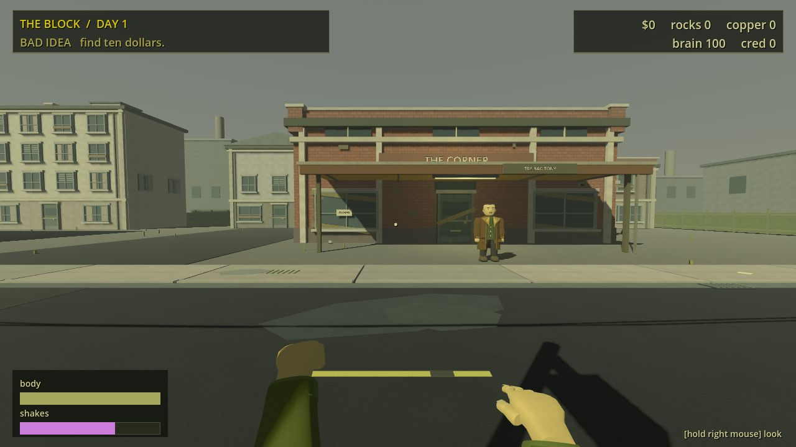
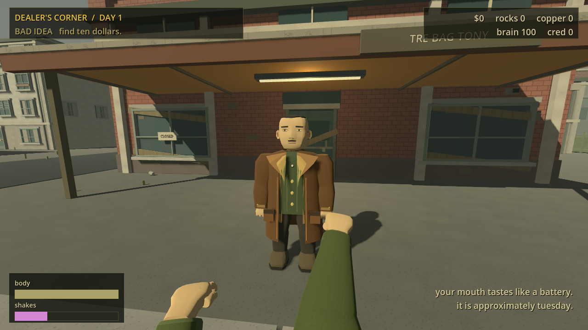
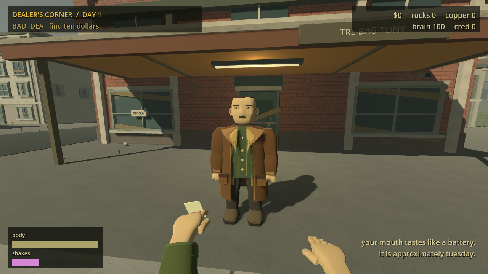

# Full 3D port — first bounded checkpoint

2026-11-18, branch `codex/3d-full-port`, source baseline `c9d61d2ce25d60737af2140206999d1242b260fa`.
This is a foundation checkpoint, **not full-game completion**. The persistent full-port goal is active.

## Playable change

First-person arms now use relaxed articulated hands, actual-travel gait, lowered sprint poses,
damped look sway, alternating punches with readable contact/recovery, and successful-action
gestures for collecting, receipts, eating, smoking and equipment. Gameplay still owns hits,
cooldowns and resources. Modal/focus pause freezes poses; new/load/death resets them.

Native pose inspection caught a punch hidden by its cuff and a floating-looking receipt grip.
The wrist/cuff and prop placements were corrected, then re-rendered. Final checks covered both
punches, rest/walk/sprint/look, receipt/eat/smoke/equip/interact/pickup and reset. Still frames do
not establish subjective motion quality. The browser was also exercised with actual movement,
sprint, punches, dialogue entry/leave and pause/Continue; no menu loop recurred.







## Full-port foundation

- Audited every live subsystem, world/actor identity and animation seam. Exported52 source hashes,
  50 modules/632 exports,23 zones,53 solids,193 props,56 day-one actors,63 canonical identities,
  24 quests,49 achievements,16 equipment,9 weapons and23 route stops. All627 serialization
  omissions are explicit, including585 function obligations; data presence is not implementation.
- Added source-unit state, equipment/stats, seeded fixed60Hz withdrawal, day/status boundaries,
  source death/arrest behavior, bounded schema2 normalization and explicit schema1 migration.
  A real roundtrip test caught dynamically assigned Godot StringName keys dropping Pete's
  locker. Generic safe JSON now normalizes those keys; ownership persists.
- Added one real smoke path, soap priority,6s/14s hitter alternative, four venue ledgers,
  condition clocks, discovery/recognition separation and source-faithful expiry behavior.
- Added all14 hustle predicates, route generation/stamps/rewards/milestones, office availability,
  ranks and faction territory. Thirteen memory and31 progression fixtures execute unchanged v22
  production functions independently before comparing the Godot model.
- Added a32-feature/585-handler ledger. Zero features are marked fully verified: production
  scene wiring, the rest of the systems and both-platform end-to-end evidence remain required.

Source defaults and model foundations are not activated in `main.gd` yet. The served checkpoint
still uses the established small neighborhood and six residents with the improved hand rig.
The separate full-map agent is resolving real blocked service points and a60.65s base-walk
critical path, caught by central physics validation. Character and economy packets are separate
work in progress. They are not counted in the green foundation runner below.

## Gate output

```text
GATE RUNNER: 19/19 PASS
3D SIMULATION GATE: PASS (106 checks)
3D SCENE GATE: PASS (92 checks)
3D ART GATE: PASS (196 checks)
3D VIEWMODEL GATE: PASS (41 checks)
3D FULL STATE GATE: PASS (211 checks)
3D MEMORY GATE: PASS (421 checks)
3D PROGRESSION GATE: PASS (898 checks)
3D CONTENT GATE PASS: 4116 assertions
3D CONTENT EXPORT CHECK PASS: source data and provenance match
3D MEMORY ORACLE: PASS (13 independent source-method fixtures)
3D PROGRESSION ORACLE: PASS (31 independent source-method fixtures)
3D PARITY COVERAGE: PASS (5578 checks;32 features,585 function obligations;0/32 verified)
3D GATE RUNNER: 12/12 PASS
3D BUILD: PASS (All; Godot4.5.1)
3D TOUR: purchase and real smoke true
3D TOUR: observed crash at17.989s; cycle complete at25.994s
3D TOUR: save schema1.0
3D TOUR: PASS
3D CAPTURE: PASS
```

The native tour used its isolated `.build/3d/qa-save.json`; no player save was overwritten.
Independent semantic review added the source's deferred tier-crossing receipt after crash,
soap's second sound, ignition/crash flash events and the far-only4% hitter-find path. These
are model event contracts awaiting the full presenter; the corrected memory gate has421 checks.
Browser QA made no purchase/save. Its console still reports Chromium capture errors, while
fallback movement, punch and menu exits work; captured-pointer feel is not claimed tested.
No new full-world/60-AI performance claim is made. Public GitHub Pages remains the2D release.
Playable local entry: `http://127.0.0.1:8073/`; Windows: `.build/3d/windows/RockBottom.exe`.

## Files and decisions

Contracts/workflow: AGENTS.md, SPEC.md, DELEGATION.md, BRAIN.md, REFACTOR-FINDINGS.md,
SPEC-3D-FULL-PORT.md, SPEC-3D-STATE.md, SPEC-3D-WORLD-PARITY.md, SPEC-3D-MEMORY-LOOP.md,
SPEC-3D-PROGRESSION.md, WORKFLOW-3D-PORT.md and three full-port inventory reports.

Runtime: main.gd, first_person_rig.gd, content_catalog.gd, game_state.gd, memory_loop.gd,
progression_routes.gd, source_content.json, parity_manifest.json, export_presets.cfg, README.md.
Associated Godot UID sidecars are tracked.

Verification: test_viewmodel.gd, viewmodel_probe.gd, test_game_state.gd, test_memory_loop.gd,
test_progression.gd, two source fixtures, run-gates.ps1, export-3d-content.mjs,
3d-content-gate.mjs,3d-memory-oracle.mjs,3d-progression-oracle.mjs,3d-parity-gate.mjs and
`artifacts/3d-full-port/p01/` evidence. Original2D runtime and frozen v19 are untouched.

Executed decisions: **IMPL-3D-FULL-01** in REFACTOR-FINDINGS.md. Full continuation is governed by
WORKFLOW-3D-PORT.md, not by treating this checkpoint as a finished port.
