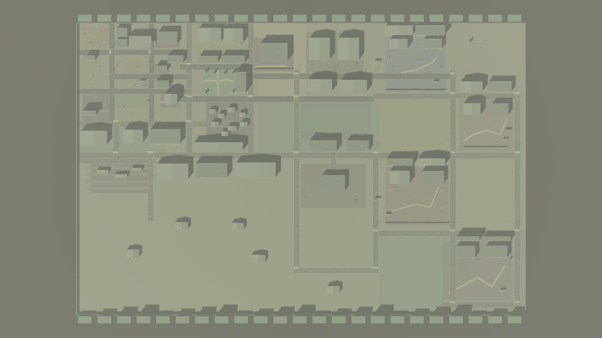
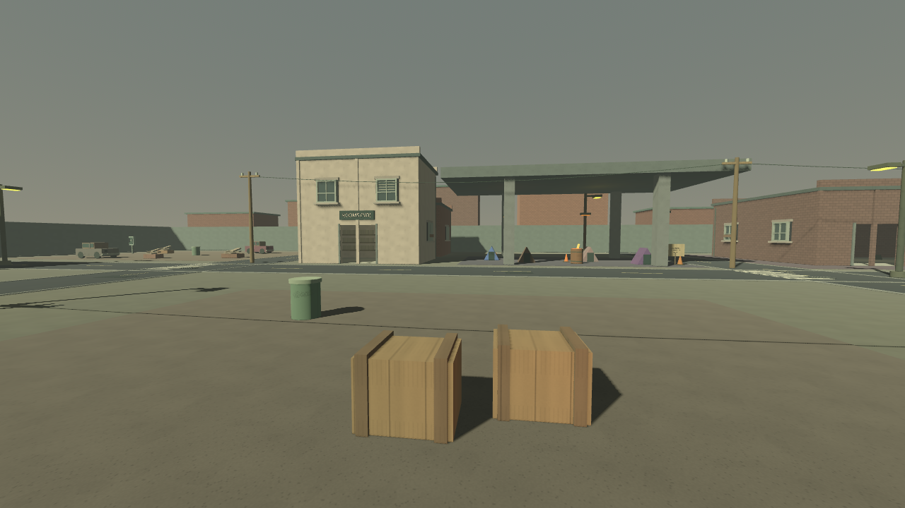
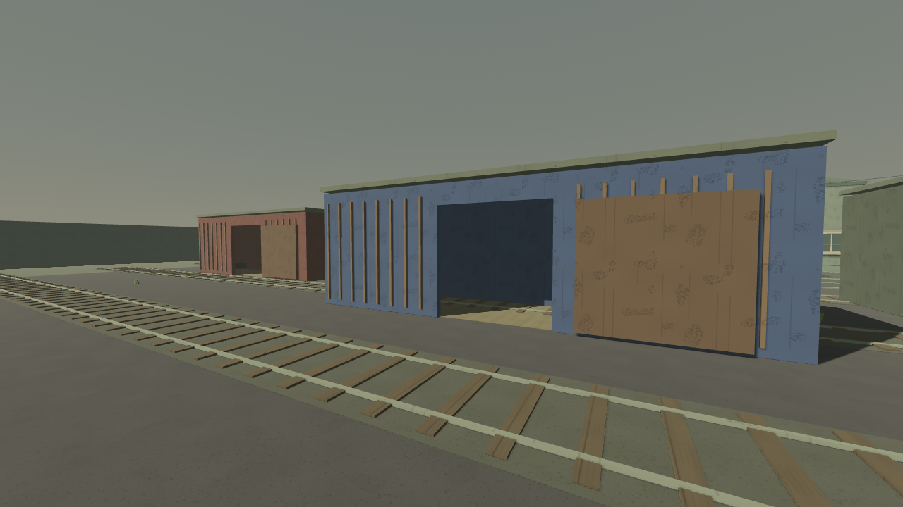
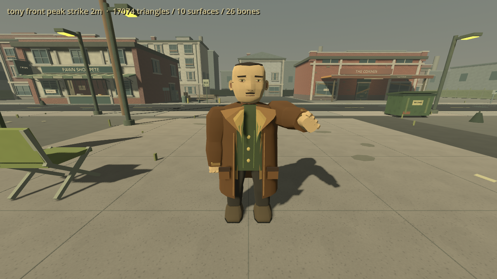
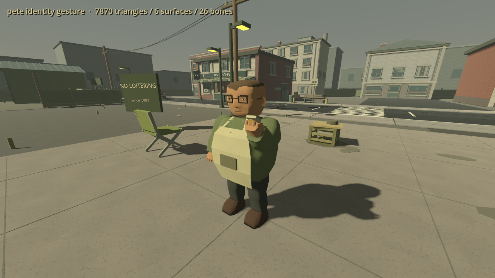

# Full 3D port — world, cast and model checkpoint

2026-11-18, branch `codex/3d-full-port`, following foundation `4b7a888`.
This is a bounded checkpoint. The full-port goal remains active; the default served scene is
still the small playable slice with the improved hands. No public deployment or full parity claim.

## Concrete additions

The complete source neighborhood now has23 zones,53 structures and193 props in original3D art,
with standing collision, authored door/legacy-actor openings, roads, utility lines, signs and
service approaches. Two embedded dumpsters received reachable openings; the train-hopper's
freight car has an open cargo bay. Fixed source anchors and normal5.5m/s walking speed remain.
All321 campaign/assignable route legs pass actual capsule sweeps. Worst measured budget is
59.396s by geometry and59.402s through actual fixed-step Runtime movement across11 waypoints,
without sprinting or intermediate teleportation. This automated trial does not measure human turns.







The six initial art identities now have real weighted Skeleton3D rigs, shared immutable meshes,
independent poses, articulated fingers, faces and props, locomotion, strikes, recoil, connected
death poses and Tony's four coat states. Tony remains unblinking; Pete holds the hot pocket.
Native review corrected shoulder continuity, strike extension, finger ownership/curl, the far
camera's blocked sightline and Pete's apron clipping into his belly. The other57 canonical visual
identities are explicitly pending; authored profiles and dedicated animal families are next.





Core vendors preserve the actual Tony/Pete/Yuri transactions, caps, faction/charisma prices,
tool displacement/locker and loans. One-use action sessions recheck live reach, state identity,
resources and gates. The full Runtime composes these with state, memory and progression;
committed consequences precede a coalesced save snapshot. Movement uses source speeds and
modifiers through actual shape casts, including pause/hitpause/stun and normalized diagonals.
An actual full-world consumer test walks from the guaranteed cash pickup to Tony, buys a rock,
and smokes at the real Block. This is physical integration evidence, not a complete playable scene.

Ordinary combat includes all nine source weapon definitions, immediate oriented melee, combos,
damage/death/arrest, physical knockback, swept projectiles, actor archetypes, police cap/radio
timers and pose snapshots. Sixty-three independent fixtures execute unchanged source functions.
Special boss/campaign deaths require a capable atomic domain handoff; missing systems do not
silently award generic loot. Bosses, robbery, remaining quest domains and main-scene wiring are
still pending. Cosmetic RNG no longer consumes gameplay rolls. A verified Brendan ReferenceError
is repaired explicitly; the shipped fists-to-pipe reward quirk is preserved and characterized.

## Verification and limits

Gate runner output is recorded below after the checkpoint run. It rejects engine error text
even on exit0. Early roster/combat script errors exposed premature success summaries; both
now require all identities/fixture groups to finish. Geometry and state tests are independent
of rendered images. The original2D source and frozen reference are untouched.

```text
GATE RUNNER: 19/19 PASS
3D SIMULATION GATE: PASS (106 checks)
3D SCENE GATE: PASS (92 checks)
3D ART GATE: PASS (196 checks)
3D VIEWMODEL GATE: PASS (41 checks)
3D FULL STATE GATE: PASS (211 checks)
3D MEMORY GATE: PASS (421 checks)
3D PROGRESSION GATE: PASS (898 checks;31 source fixtures)
3D ECONOMY GATE: PASS (585 checks;23 source fixtures)
FULL WORLD GEOMETRY PASS:7789 checks;0 failures;321 physical legs
3D CHARACTER ROSTER GATE: PASS (159 checks)
3D COMBAT GATE: PASS (2870 checks;63 source fixtures)
3D FULL RUNTIME GATE: PASS (55 checks)
3D PHYSICS ADAPTER GATE: PASS (21 checks)
3D FULL INTEGRATION GATE: PASS (230 checks; critical actual-controller walk59.4019668s)
3D CONTENT GATE PASS:4116 assertions
3D CONTENT EXPORT CHECK PASS
3D MEMORY ORACLE: PASS (13 independent source-method fixtures)
3D PROGRESSION ORACLE: PASS (31 independent source-method fixtures)
3D ECONOMY ORACLE: PASS (23 independent source-method fixtures)
3D WORLD ORACLE CHECK PASS
3D COMBAT ORACLE: PASS (63 source fixtures;Brendan defect characterized)
3D PARITY COVERAGE: PASS (5578 checks;32 features,585 function obligations;0/32 verified)
3D GATE RUNNER:22/22 PASS
```

Native world probe:62 day/night PNGs, all23 zones, seven service interiors and two overheads.
Native roster probe:58 PNGs, close/far/quarter views, walk/strike/hurt/death, coats and identity
gestures. Selected views were visually reviewed; captures remain geometry/pose evidence, not
gameplay or subjective animation acceptance. Device: NVIDIA GeForce RTX3080, Compatibility,
1280x720. World geometry build was1.49s in the first final run:132,798 triangles,585 batches,
1,114 physical obstacles and846 navigation footprints. These are build counts, not frame times.
`find_route` is an occasional global query (~200ms observed), never a per-actor/per-frame call.
Production60+ AI/render performance remains an explicit unfinished requirement.

Current local playable entry remains `http://127.0.0.1:8073/`. New foundations are exercised by
`pwsh -File game3d/tests/run-gates.ps1`; full source parity still fails the intentional completion
gate. Subsequent bounded packets cover full cast, bosses, travel, interactions/activities,
campaigns, days/communications, complete presentation and native/Web whole-game acceptance.

## Files and executed decisions

Contracts: SPEC-3D-WORLD-BUILD.md, SPEC-3D-CHARACTER-ROSTER.md, SPEC-3D-ECONOMY.md,
SPEC-3D-COMBAT.md, SPEC-3D-RUNTIME.md and SPEC-3D-PHYSICS-ADAPTER.md. Ledger/docs:
WORKFLOW-3D-PORT.md, DELEGATION.md, BRAIN.md, REFACTOR-FINDINGS.md, game3d/README.md,
reports/3d-full-port-animation-inventory.md and this report.

Runtime: full_neighborhood.gd, character_roster.gd, actor_animation.gd, inventory.gd,
action_session.gd, vendors_core.gd, combat_system.gd, actor_director.gd, full_runtime.gd,
world_adapter.gd and their generated UID sidecars.

Verification: test_economy.gd, test_full_world.gd, test_character_roster.gd, test_combat.gd,
test_full_runtime.gd, test_world_adapter.gd, test_full_integration.gd, test_progression.gd,
character_roster_probe.gd, full_world_probe.gd, run-gates.ps1 and associated UID sidecars;
three tools/3d-*-oracle.mjs scripts and economy/world_routes/combat reference JSON fixtures.
Selected native evidence lives in artifacts/3d-full-port/p04 and p05.

Executed register: `IMPL-3D-FULL-02` in REFACTOR-FINDINGS.md. Travel, boss and full-cast draft
files outside these listed checkpoint files remain work in progress.
